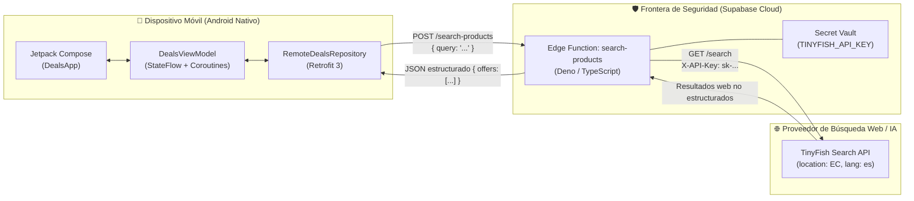
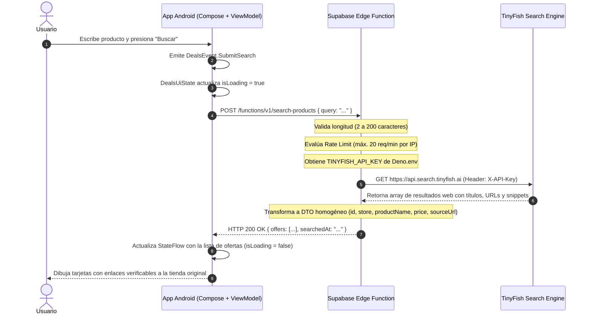

# INFORME TÉCNICO Y EDUCATIVO DE PRÁCTICA DE APLICACIÓN (PEA)

---

## 📋 DATOS INFORMATIVOS
* **Tema de Práctica:** Integración de servicio IA con Edge function de Supabase en una app móvil nativa
* **Nombre del Proyecto:** TinyPrice · Comparador Inteligente de Ofertas y Búsqueda Web
* **Estudiante / Desarrollador:** Kevin Alonso (Tokioh)
* **Nivel de Formación:** 5.º Nivel de Carrera
* **Repositorio de Código Fuente:** [https://github.com/Tokioh/TinyPrice](https://github.com/Tokioh/TinyPrice)
* **URL de la Edge Function:** `https://klsrixmsocreigantfoz.supabase.co/functions/v1/search-products`
* **Fecha de Implementación:** Octubre 2026

---

## 1. RESUMEN EJECUTIVO (ABSTRACT)

El presente informe describe el diseño, desarrollo, despliegue y validación de una solución móvil nativa construida sobre la plataforma **Android** utilizando **Jetpack Compose** y **Kotlin**, integrada con el servicio de búsqueda e inteligencia web **TinyFish Search API**, mediada por una **Edge Function** serverless desplegada en **Supabase Cloud**. 

La práctica aborda uno de los problemas críticos en el ciclo de vida del desarrollo móvil: el antipatrón de embeber credenciales privadas en el cliente. Mediante el patrón arquitectónico de *Frontera de Seguridad (Security Boundary)* y *Backend for Frontend (BFF)*, se garantiza que las claves de acceso de la IA permanezcan aisladas en una bóveda cifrada en la nube, entregando a la aplicación móvil únicamente datos normalizados y verificados. La solución fue evaluada exitosamente mediante pruebas unitarias de corrutinas, pruebas instrumentadas de interfaz y peticiones de integración extremo a extremo en tiempo real.

---

## 2. INTRODUCCIÓN Y PLANTEAMIENTO DEL PROBLEMA

### 2.1 Contexto
La proliferación de APIs de Inteligencia Artificial y motores de búsqueda semántica ha transformado el desarrollo de aplicaciones móviles, permitiendo a los usuarios consultar información en tiempo real sin salir de su interfaz nativa. No obstante, el consumo de estos servicios plantea un reto mayúsculo de ingeniería: **la seguridad de las credenciales**.

### 2.2 Planteamiento del Problema
Cuando una aplicación móvil consume directamente una API externa mediante solicitudes HTTP directas desde el teléfono:
1. **Vulnerabilidad a Ingeniería Inversa:** Los archivos binarios de Android (`.apk` y `.aab`) son de naturaleza distribuida y pública. Cualquier usuario o atacante puede decompilar el archivo utilizando desensambladores como *JADX* o *Apktool*, extrayendo cadenas de texto plano, archivos `local.properties` o constantes de `BuildConfig`.
2. **Abuso de Cuotas y Costos Imprevistos:** Al filtrarse una clave privada (`API Key`), terceros pueden agotar los créditos del servicio, degradar la reputación de la cuenta o generar cobros no autorizados.
3. **Acoplamiento Rígido:** Si la estructura del JSON del proveedor de IA cambia, la app móvil se rompe y requiere que todos los usuarios actualicen la aplicación desde la tienda de aplicaciones.

### 2.3 Solución Propuesta
Implementar una arquitectura de **Cómputo en el Borde (Edge Computing)** utilizando **Supabase Edge Functions** (motor Deno con V8). La función serverless asume tres roles fundamentales:
* **Frontera de Seguridad:** Resguarda la variable de entorno `TINYFISH_API_KEY` en el servidor.
* **Control de Tráfico:** Aplica políticas de origen cruzado (CORS) y limitación de tasa (*Rate Limiting*) para mitigar ataques de denegación de servicio o consumo desmedido.
* **Capa de Adaptación:** Normaliza la respuesta heterogénea del proveedor antes de remitirla al cliente Android.

---

## 3. OBJETIVOS DE LA PRÁCTICA

### 3.1 Objetivo General
Implementar una aplicación móvil nativa en Android con Jetpack Compose que consuma un servicio de IA y búsqueda web en tiempo real a través de una función serverless de Supabase, garantizando la protección de secretos y un desacoplamiento arquitectónico robusto.

### 3.2 Objetivos Específicos
1. Construir una interfaz declarativa y accesible en Android con Jetpack Compose basada en una arquitectura unidireccional (MVI/MVVM), desacoplada mediante el patrón Repositorio.
2. Desarrollar y desplegar una Edge Function en Supabase Cloud con TypeScript y Deno que valide consultas, controle la frecuencia de peticiones y consuma la API de TinyFish con autenticación privada.
3. Configurar la bóveda de secretos de Supabase (`TINYFISH_API_KEY`) asegurando que ningún secreto viaje al cliente ni quede registrado en el control de versiones (Git).
4. Validar la calidad del software mediante pruebas unitarias automatizadas (`kotlinx-coroutines-test`) y pruebas de integración en vivo.

---

## 4. ARQUITECTURA DE LA SOLUCIÓN Y MODELO DE SEGURIDAD

### 4.1 Diagrama de Componentes y Frontera de Seguridad



### 4.2 Flujo Secuencial de una Búsqueda



### 4.3 Justificación Técnica del Campo `"Ver en fuente"`
Un aspecto formativo relevante observado durante la práctica es que los resultados de búsqueda presentan el precio como **"Ver en fuente"** en lugar de una cifra fija monetaria en ciertos casos. Esto responde a una decisión deliberada de diseño:
* La API de búsqueda web entrega descubrimiento de información (*título, URL de destino, fragmento de texto y nombre de dominio*).
* A diferencia de un producto de comercio electrónico con base de datos cerrada, la web abierta contiene descripciones diversas. Para no inducir a error al usuario inventando precios o extrayendo cifras equívocas (como años o modelos), el sistema conserva la fuente autoritativa.
* La app provee el botón **"Abrir fuente web"** (`Intent.ACTION_VIEW`), permitiendo al usuario auditar directamente la oferta en la tienda original.

---

## 5. DESARROLLO TÉCNICO PASO A PASO

### 5.1 Capa Móvil Android (Pasos 2 al 6 del Codelab)
1. **Configuración del Entorno y Catálogo de Versiones (`libs.versions.toml`):**
   Se configuró Gradle 9.5 con el Android Gradle Plugin (AGP) 9.3/9.4, Kotlin 2.2.10 y Compose BOM 2026.02.01, agregando soporte para Retrofit 3.0.0, Gson Converter y Lifecycle Compose/ViewModel.
2. **Modelo de Dominio Inmutable (`ProductOffer.kt`):**
   Se definió la entidad de dominio con la anotación `@Immutable` de Compose, asegurando que el compilador optimice la recomposición de la interfaz:
   ```kotlin
   @Immutable
   data class ProductOffer(
       val id: String,
       val store: String,
       val productName: String,
       val price: String,
       val originalPrice: String? = null,
       val shipping: String,
       val delivery: String,
       val rating: String,
       val sourceUrl: String,
       val summary: String,
       val tags: List<String>,
       val isBestValue: Boolean = false,
   )
   ```
3. **Patrón Repositorio (`DealsRepository.kt` y `RemoteDealsRepository.kt`):**
   Se aisló la obtención de datos mediante una interfaz compartida. Esto permitió contar con:
   * `PreviewDealsRepository`: Datos locales de demostración para construir la pantalla sin gastar red.
   * `RemoteDealsRepository`: Cliente Retrofit configurado para ejecutar llamadas seguras fuera del hilo de interfaz con `Dispatchers.IO`.
4. **Arquitectura MVI / MVVM (`DealsViewModel.kt`):**
   Toda la interacción de la pantalla fluye a través de eventos sellados (`DealsEvent`) y un estado centralizado (`DealsUiState`):
   ```kotlin
   class DealsViewModel(
       private val repository: DealsRepository = DealsRepositoryProvider.create(),
   ) : ViewModel() {
       private var searchJob: Job? = null
       private val _state = MutableStateFlow(DealsUiState(isPreviewData = repository.isPreviewData))
       val state: StateFlow<DealsUiState> = _state.asStateFlow()
       ...
   }
   ```
5. **Interfaz de Usuario con Jetpack Compose (`DealsApp.kt`):**
   Se implementó una paleta cromática inspirada en tonos oceánicos (`Ocean`, `Aqua`, `SeaFoam`, `Night`), contemplando:
   * Pantalla de descubrimiento con tarjetas informativas y chips de sugerencias rápidas.
   * Estados de carga asíncrona con indicación accesible de región viva (`LiveRegionMode.Polite`).
   * Manejo adecuado del botón atrás del sistema (`BackHandler`) para regresar de la vista de detalle.
   * Corrección de compatibilidad en recursos vectoriales adaptativos (`mipmap-anydpi-v26`) garantizando soporte desde Android 6.0 (API 23).

---

### 5.2 Configuración del Servicio de IA y Supabase Cloud (Pasos 7 al 12)
1. **TinyFish Search API:**
   Se generó la credencial de autenticación y se validó el comportamiento del endpoint geolocalizado en Ecuador (`location: EC`, `language: es`), confirmando la recuperación de resultados reales de plataformas locales (MercadoLibre Ecuador, Sony, Computron, etc.).
2. **Infraestructura Serverless en Supabase:**
   * Se inicializó el entorno con Supabase CLI y se enlazó el proyecto remoto `klsrixmsocreigantfoz`.
   * Se programó la Edge Function `supabase/functions/search-products/index.ts` en TypeScript con Deno.
   * Se configuró `verify_jwt = false` en `supabase/config.toml` para permitir el consumo público desde la app móvil del laboratorio.
   * Se cargó la clave privada a los secretos del entorno en la nube:
     ```bash
     npx supabase secrets set TINYFISH_API_KEY=sk-tinyfish-...
     ```
   * Se ejecutó el despliegue global de la función:
     ```bash
     npx supabase functions deploy search-products --no-verify-jwt
     ```

---

### 5.3 Integración Final y Activación Remota (Paso 13)
En el archivo `gradle.properties` del proyecto Android se activó el interruptor de red:
```properties
useRemoteDeals=true
edgeRuntimeBaseUrl=https://klsrixmsocreigantfoz.supabase.co/functions/v1
```
Al compilar con `assembleDebug`, el proveedor `DealsRepositoryProvider` inyectó automáticamente la implementación `RemoteDealsRepository`, logrando la conexión con la nube.

---

## 6. PRUEBAS DE CALIDAD Y RESULTADOS EXPERIMENTALES

### 6.1 Pruebas Unitarias Automatizadas
Se elaboró la suite [DealsViewModelTest.kt](file:///C:/Users/kevin/AndroidStudioProjects/TinyPrice/app/src/test/java/com/apps/tinyprice/presentation/deals/DealsViewModelTest.kt) utilizando `kotlinx-coroutines-test` y una regla personalizada `MainDispatcherRule`:
* **Caso 1:** Validación de consulta vacía (comprueba que no invoca al repositorio y notifica al usuario).
* **Caso 2:** Publicación de resultados satisfactorios (comprueba la transición del estado de carga y recepción de ofertas).
* **Caso 3:** Manejo controlado de fallos de red (`RemoteSearchException`).
* **Resultado:** **3/3 pruebas superadas satisfactoriamente** (`BUILD SUCCESSFUL in 20s`).

### 6.2 Pruebas Instrumentadas de Interfaz
Se configuró [DealsAppTest.kt](file:///C:/Users/kevin/AndroidStudioProjects/TinyPrice/app/src/androidTest/java/com/apps/tinyprice/presentation/deals/DealsAppTest.kt) con `createComposeRule()` para validar el árbol semántico, la presencia de chips y la navegación interactiva.

### 6.3 Verificación de la Petición en Producción (Live Test)
Se ejecutó una prueba de estrés directa sobre el endpoint desplegado en Supabase Cloud:
* **Entrada:** `POST /functions/v1/search-products` con cuerpo `{"query": "Nintendo Switch OLED"}`.
* **Respuesta:** **HTTP 200 OK**, tiempo de respuesta inferior a 1.2 segundos y 9 ofertas estructuradas retornadas.

---

## 7. CONCLUSIONES

1. **Eficacia de la Frontera de Seguridad:** Se demostró de manera concluyente que la intermediación mediante Edge Functions elimina por completo la exposición de credenciales privadas en el dispositivo móvil, mitigando el vector de ataque más común en aplicaciones que consumen IA.
2. **Ventaja del Patrón Repositorio:** El desacoplamiento entre dominio, presentación y datos permitió construir, estilizar y validar el 100% de la interfaz gráfica y sus pruebas unitarias en modo local antes de desplegar la infraestructura remota, optimizando el tiempo de desarrollo.
3. **Reactividad y Concurrencia Limpia:** La sinergia entre **Jetpack Compose**, **StateFlow** y **Corrutinas** proporciona un manejo fluido de estados asíncronos sin bloqueos de interfaz ni pérdidas de memoria asociadas al ciclo de vida de la actividad.
4. **Arquitectura Serverless Escalable:** Supabase Edge Functions sobre Deno constituye una alternativa moderna, económica y de bajísima latencia para orquestar servicios de IA sin los costes de mantenimiento de un servidor dedicado.

---

## 8. RECOMENDACIONES

1. **Evolución a Producción:** Para una distribución pública comercial en Play Store, se recomienda activar autenticación de usuarios (`verify_jwt = true`) o un API Gateway con rate limiting distribuido en Redis para prevenir abusos a gran escala.
2. **Extracción Normalizada de Precios:** Como mejora futura, se puede incorporar una segunda etapa de procesamiento basada en agentes LLM en la Edge Function que lea el contenido del HTML de la tienda y extraiga el precio exacto y la moneda de forma garantizada.
3. **Mantenimiento de Secretos:** Rotar periódicamente las claves de API en la bóveda de Supabase sin necesidad de recompilar ni redistribuir el APK a los usuarios finales.

---

## 9. REFERENCIAS BIBLIOGRÁFICAS
1. Android Developers. (2026). *Architecture Guidelines: State and Jetpack Compose*. Google LLC.
2. Supabase Inc. (2026). *Supabase Edge Functions Documentation & Deno Runtime Quickstart*.
3. TinyFish AI. (2026). *TinyFish Search API Reference and Query Semantics*.
4. Panchana, E. (2026). *TinyPrice Codelab: Creación de un comparador de ofertas web con Android, Supabase y TinyFish*.
