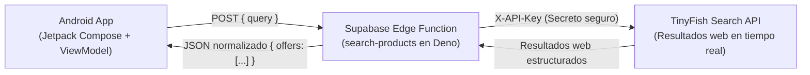

# TinyPrice · Comparador de Ofertas con Búsqueda Web Real e IA

> **PEA:** Integración de servicio IA con Edge function de Supabase en una app móvil nativa.

Aplicación móvil nativa en **Android (Jetpack Compose)** para comparar precios y buscar ofertas en la web mediante el servicio de búsqueda de **TinyFish**, protegiendo las credenciales privadas detrás de una **Edge Function desplegada en Supabase Cloud**.

---

## 🏛 Arquitectura de la Solución

El proyecto implementa un patrón de **Frontera Segura (Security Boundary)** para evitar que la clave privada del proveedor de IA/Búsqueda se exponga en el cliente móvil o en el binario APK.



---

## 🚀 Tecnologías y Herramientas

- **Móvil (Android Nativo):**
  - **Lenguaje:** Kotlin 2.2.10
  - **UI Toolkit:** Jetpack Compose (BOM 2026.02.01) con Material 3 y paleta oceánica.
  - **Arquitectura:** MVI / MVVM Unidireccional con `StateFlow`, corrutinas y `Lifecycle`.
  - **Red:** Retrofit 3.0.0 + Gson Converter + OkHttp3.
  - **Pruebas:** JUnit 4, `kotlinx-coroutines-test` y Compose UI Testing (`createComposeRule`).
- **Cloud & Backend Serverless:**
  - **Plataforma:** Supabase Cloud.
  - **Runtime:** Supabase Edge Functions (Deno / TypeScript).
  - **Seguridad:** Supabase Secrets Vault (`TINYFISH_API_KEY`).
  - **Control de tráfico:** Rate limiting y manejo de CORS.
- **Servicio de Búsqueda:**
  - **Proveedor:** TinyFish Search API (búsqueda web con extracción semántica y filtrado geográfico).

---

## 📁 Estructura del Proyecto

```text
TinyPrice/
├── app/
│   ├── src/
│   │   ├── main/
│   │   │   ├── AndroidManifest.xml
│   │   │   └── java/com/apps/tinyprice/
│   │   │       ├── MainActivity.kt
│   │   │       ├── data/
│   │   │       │   ├── model/ProductOffer.kt
│   │   │       │   ├── remote/ (SearchProductsDto, TinyPriceApi, TinyPriceApiFactory)
│   │   │       │   └── repository/ (DealsRepository, RemoteDealsRepository)
│   │   │       ├── presentation/deals/ (DealsApp, DealsViewModel)
│   │   │       └── ui/theme/ (Color, Theme, Type)
│   │   ├── test/ (DealsViewModelTest, MainDispatcherRule)
│   │   └── androidTest/ (DealsAppTest)
│   └── build.gradle.kts
├── supabase/
│   ├── config.toml
│   └── functions/
│       └── search-products/
│           └── index.ts
├── gradle/libs.versions.toml
├── gradle.properties
└── package.json
```

---

## ⚙️ Configuración y Ejecución

### 1. Requisitos Previos
- JDK 17 o superior (compatible con JDK 25).
- Android Studio Ladybug / Koala o superior (SDK 37 instalado).
- Node.js 20+ y Supabase CLI.

### 2. Variables de compilación (`gradle.properties`)
```properties
useRemoteDeals=true
edgeRuntimeBaseUrl=https://klsrixmsocreigantfoz.supabase.co/functions/v1
```

### 3. Compilación y Ejecución
Para compilar y generar el APK:
```bash
./gradlew :app:assembleDebug
```

Para ejecutar las pruebas unitarias:
```bash
./gradlew testDebugUnitTest
```
